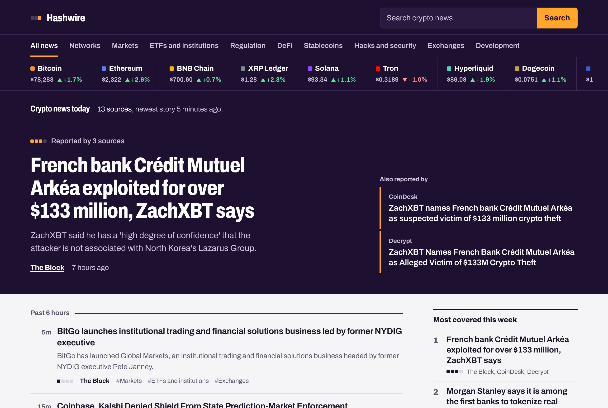
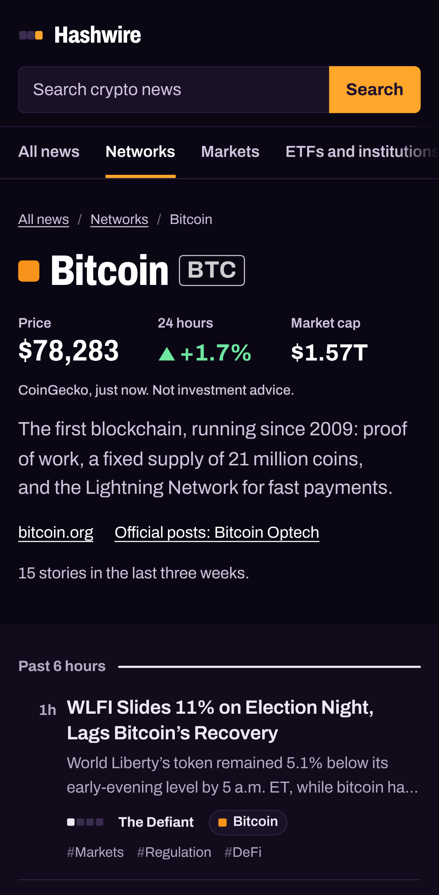

# Hashwire

**Live: [hashwire.vercel.app](https://hashwire.vercel.app)**

Crypto and blockchain news, network by network. Hashwire reads 13 feeds every 15 minutes: crypto newsrooms, the networks' own teams and exchange listings. It tags every story with the blockchains it's about. Pick Bitcoin, Ethereum, Solana or any of 22 networks to read only that network's news, next to its price and 24-hour change.

<p align="center">
  
  &nbsp;
  
</p>

| Lighthouse | Performance | Accessibility | Best practices | SEO |
|---|---|---|---|---|
| Mobile | 94–97 on network pages, 78–94 on the home page (it varies between runs) | 100 | 100 | 100 |
| Desktop | 100 | 100 | 100 | 100 |

## Features

- **A page for every network.** 22 networks, from Bitcoin and Ethereum to layer 2s like Arbitrum and Base, each at `/network/<name>`. A page shows its price, 24-hour change and market cap, links to the network's own posts, and lists only the news about it.
- **Networks on every story.** Each story carries chips for the networks it mentions, and every chip links to that network's page.
- **Prices up front.** A strip of the largest networks by market cap with prices and 24-hour changes leads the front page. A [networks table](https://hashwire.vercel.app/networks) lists all 22 with this week's story count. Rises are green with ▲ and falls red with ▼, so colour is never the only signal.
- **One story, all its coverage.** Reports of the same news are grouped automatically. A network team's own post leads when there is one, and the other coverage is listed under it.
- **Official posts are marked**, so a network's own announcement is never confused with reporting about it.
- **Eight topics:** markets, ETFs and institutions, regulation, DeFi, stablecoins, hacks and security, exchanges, development.
- **Biggest 24-hour moves**, the most covered stories of the week, search, a "new since your last visit" marker, its own [RSS feed](https://hashwire.vercel.app/feed.xml), light and dark themes, and it works without JavaScript.

### Sources

| Newsrooms | Network teams | Exchanges |
|---|---|---|
| CoinDesk, Cointelegraph, Decrypt, The Block, Bitcoin Magazine, CryptoSlate, The Defiant | Ethereum Foundation, Bitcoin Optech, Solana, Sui, Base | Kraken (listings and new features) |

Prices come from [CoinGecko](https://www.coingecko.com/). Hashwire shows each story's headline, a short excerpt when the feed provides one, and a link to the original article. It never copies full articles. Nothing on the site is investment advice.

## Tech stack

| Area | Choice |
|---|---|
| Framework | [Next.js 16](https://nextjs.org) (App Router, Server Components, Route Handlers, Proxy) |
| Language | TypeScript (strict) |
| UI | React 19, hand-written CSS, Archivo variable font (weight and width axes) self-hosted from npm |
| Feeds | RSS 2.0, RSS 1.0 and Atom parsed with [fast-xml-parser](https://github.com/NaturalIntelligence/fast-xml-parser); text cleaned with [entities](https://github.com/fb55/entities) |
| Prices | CoinGecko `/simple/price`, one request for every network |
| Caching | `unstable_cache`: each feed for 15 minutes, prices for 10 minutes |
| Tests | Vitest (78 unit and API tests), Playwright (50 end-to-end runs on desktop and mobile), axe-core accessibility checks |
| CI | GitHub Actions: lint, type check, unit tests, build, end-to-end tests |
| Hosting | Vercel |

## How it works

```
13 RSS/Atom feeds ──▶ fetch + parse ──▶ clean + filter ──▶ networks + topics ──▶ group ──▶ pages, RSS, sitemap
CoinGecko prices ──▶ fetch + validate ───────────────────────────────────────────────────▶ strip, tables, network pages
```

- **Each feed and the prices are fetched and cached separately** (`src/lib/feeds.ts`). A slow or broken feed times out after 10 seconds, shows up on the sources page, and never holds up the rest. If CoinGecko is down, the news still works and the prices are simply left out.
- **Everything after the fetch is pure functions with unit tests**: parsing (`parse.ts`), cleaning and filtering (`stories.ts`), network tagging (`networks.ts`), prices (`prices.ts`), topics (`topics.ts`) and grouping (`cluster.ts`).
- **Feed text and API data are untrusted.** HTML becomes plain text rendered by React. Links must be `http(s)`, tracking parameters are removed, and responses over 5 MB are refused. Price fields that aren't positive finite numbers are dropped.
- **Feeds get cleaned up per source.** Bitcoin Magazine repeats its name and headline at the start of every summary; CryptoSlate ends each one with "Read the full story on CryptoSlate". Both are stripped. Decrypt's AI stories, The Block's explainers, Cointelegraph's daily round-up and Kraken's event posts are left out.

### How stories are tagged with networks

Each network has a rule for its names, products and people, plus case-sensitive rules for its ticker (`src/lib/networks.ts`). The tricky part is that several names are ordinary words:

| Network | Counts | Doesn't count |
|---|---|---|
| Base | "on Base", "Base app", "Coinbase's Base" | "base rates" |
| Avalanche | "Avalanche L1", "Ava Labs", "AVAX" | "an avalanche of liquidations" |
| Optimism | "OP Mainnet", "OP Stack", "Superchain" | "a wave of optimism" |
| NEAR | "NEAR" in capitals, "NEAR Protocol" | "near even" |
| Dogecoin | "Dogecoin" | "DOGE" alone (also a US government department) |
| Ethereum | "Ethereum", "ETH", "Glamsterdam" | "layer 2" alone (Bitcoin has them too) |

Posts from a network's own blog are always tagged with that network. The unit tests pin all of these cases.

### How stories are grouped

Two stories from different sources, published within three days of each other, are the same news when:

1. their headlines share at least three words and 30% of all their words, or
2. they share words that **no other story on the wire uses**, scoring 2 for a word in both headlines, 1 for a word in one headline and 0.5 for a word only in the summaries, with a total of at least 3.

Crypto newsrooms use the same vocabulary all day, so the bar is high. "SEC division views Canton Coin as digital commodity" and "SEC ruling lifts Canton Coin 6%" group together, because they share *Canton* and *Coin*. "South Korea's ruling party…" doesn't join them, because the shared word *ruling* means something else. The unit tests check these cases against a saved snapshot of the real feeds.

## SEO

- A unique title, description, canonical URL and social image on every page. Network and topic pages get their own generated images.
- 22 network pages, 8 topic pages and 13 source pages are indexable landing pages ("Solana (SOL) news and price today"), each with its own introduction.
- `sitemap.xml` lists every page with the time of its newest story; `robots.txt` points to it. Search results are `noindex, follow`.
- Structured data: `WebSite` with a search action and an `ItemList` on the home page; `CollectionPage`, `ItemList` and a three-level `BreadcrumbList` (Hashwire, Networks, network) on section pages.
- RSS `<link rel="alternate">` on every page, a web app manifest and icons. Unknown networks, topics and sources return a real `404`.
- Google Search Console verification through `GOOGLE_SITE_VERIFICATION`.

## Security and accessibility

- A strict Content Security Policy with a fresh nonce on every request (`src/proxy.ts`), plus `X-Frame-Options`, `Referrer-Policy`, HSTS and a `Permissions-Policy` that switches everything off. Network colours are drawn as SVG fills so that no inline styles are needed.
- No secrets required. The optional CoinGecko key stays on the server.
- Google Analytics is opt-in through `GA_MEASUREMENT_ID` and loads under the same nonce-based policy.
- Landmarks, a skip link, visible focus, one `h1` per page, readable contrast in both themes, and price changes spoken in words ("up 1.7% in 24 hours"). The networks table has a caption and row headers and can be scrolled with the keyboard. End-to-end tests run axe-core on every page type and fail on any serious WCAG 2.1 AA issue.

## Run it locally

You need Node.js 20.9 or newer.

```bash
npm install
npm run dev                      # http://localhost:3000, live feeds and prices
```

To work offline, use the built-in snapshot of the real feeds and prices (taken on 4 November 2026):

```bash
NEWS_SAMPLE_DATA=1 npm run dev
```

### Environment variables

All are optional.

| Name | What it does |
|---|---|
| `COINGECKO_API_KEY` | A free CoinGecko Demo key. Prices work without it; with it, the rate limit is higher. |
| `SITE_URL` | Public address for canonical links, the sitemap and social cards. Defaults to `https://hashwire.vercel.app` on Vercel and `http://localhost:3000` elsewhere. |
| `GA_MEASUREMENT_ID` | Google Analytics 4 measurement ID (`G-…`). When unset, nothing from Google loads. |
| `GOOGLE_SITE_VERIFICATION` | The `content` value of Google Search Console's HTML tag verification. |
| `NEWS_SAMPLE_DATA` | Set to `1` to use the snapshot in `src/lib/fixtures` instead of live feeds and prices. Ignored in Vercel production. |

## Scripts

| Command | What it does |
|---|---|
| `npm run dev` | Start the development server |
| `npm run build` / `npm start` | Build and run the production server |
| `npm run lint` | ESLint |
| `npm run typecheck` | Generate route types and run the TypeScript compiler |
| `npm test` | Unit and API tests (Vitest) |
| `npm run test:e2e` | End-to-end and accessibility tests with Playwright, against the production build and the snapshot |

Before running `npm run test:e2e` the first time, install the browser with `npx playwright install chromium`, and build with `NEWS_SAMPLE_DATA=1 npm run build`.

## Adding a network or a source

- **Network:** add an entry to `NETWORKS` in `src/lib/networks.ts` with its name, ticker, CoinGecko id, colour, homepage, a one-line description and matching rules. Add a test case for a headline that should match, and one that shouldn't.
- **Source:** add an entry to `SOURCES` in `src/lib/sources.ts`. Set `network` if it's a network's own blog, and `include` to filter its posts. Then add a few items for it to `src/lib/fixtures/snapshot.json`; a unit test checks that every source has sample data.

## Deploy to Vercel

1. Import this repository in Vercel. It detects Next.js; there are no settings to change.
2. Optionally add `COINGECKO_API_KEY`, `GA_MEASUREMENT_ID` and `GOOGLE_SITE_VERIFICATION` under **Settings → Environment Variables**.
3. Deploy. Every push to `main` deploys again.

## Project structure

```
src/
  app/
    page.tsx                  Front page: network strip, lead story, wire
    networks/                 All networks with prices
    network/[slug]/           One network: price, official posts, its news (+ social image)
    topic/[slug]/, source/[slug]/, sources/, about/, search/
    feed.xml/route.ts         Hashwire's own RSS feed
    sitemap.ts, robots.ts, manifest.ts, opengraph-image.tsx, apple-icon.tsx, icon.svg
    layout.tsx, not-found.tsx, error.tsx, globals.css
  components/                 Frame, network strip, table, chips, prices, lead, story list, side panels
  lib/
    networks.ts               The 22 networks and how stories are matched to them
    prices.ts                 CoinGecko request, validation and number formatting
    sources.ts                The 13 feeds and their filters
    feeds.ts                  Fetching and caching (server only)
    parse.ts                  RSS and Atom parsing
    stories.ts, text.ts       Cleaning, filtering, safe URLs
    topics.ts                 Topic rules and page copy
    cluster.ts                Grouping reports of the same news
    load.ts                   One wire per request, filters, search
    time.ts, site.ts, csp.ts, analytics.ts, og.tsx
    fixtures/                 Saved feed and price snapshots for development and tests
  proxy.ts                    Content Security Policy with nonces; 404 for unknown sections
e2e/                          Playwright tests
```

Hashwire is the sister site of [Tensorwire](https://github.com/Shahryartariq/tensorwire), which does the same for AI news. Both share the same feed pipeline.

## Credits

Headlines and excerpts belong to their publishers and link to the original articles. Prices by CoinGecko. Built by [Muhammad Shehryar](https://github.com/Shahryartariq).

## License

[MIT](LICENSE)
